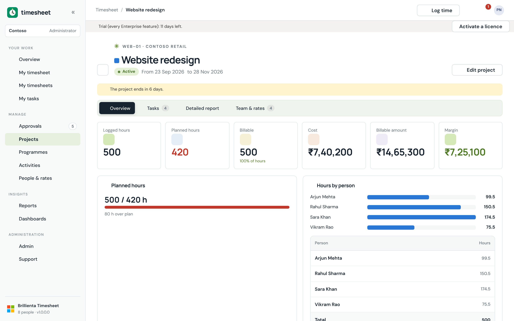

# Brillienta Timesheet

Timesheets, projects, approvals and cost reports for **SharePoint Online and Microsoft Teams**, built as an SPFx web
part in the same design system as Brillienta Employee Directory (navy and lime, Manrope and DM Sans, full-screen
workspace with a side navigation). Everything is stored in SharePoint lists on your own site. Nothing leaves your tenant
except the emails and Teams messages you switch on.

- **Package:** `sharepoint/solution/Brillienta-Timesheet.sppkg` (built by `npm run build`)
- **SPFx:** 1.23.2 · React 17 · Fluent UI 8 · Node 22
- **Solution id:** `68060ea7-a75d-47d6-bd5f-685afeabbaf0` · **web part id:** `ff5b1593-a3b3-45f5-b3a5-8d11821fc2a1`



See also: [Enterprise feature checklist](docs/ENTERPRISE-CHECKLIST.md).

## Contents

1. [Feature map](#1-feature-map) — every item of the plans and where it is in the app
2. [Plans and licensing](#2-plans-and-licensing)
3. [Roles](#3-roles)
4. [Install and deploy](#4-install-and-deploy)
5. [Data model (SharePoint lists)](#5-data-model)
6. [Integrations](#6-integrations)
7. [Security model](#7-security-model)
8. [Development](#8-development)
9. [Code map](#9-code-map)

---

## 1. Feature map

| Feature | Plan | Where | How it works |
| --- | --- | --- | --- |
| Weekly timesheets with approvals | Standard | My timesheet | Grid of project · task · activity lines with hours per day, notes per day, save draft (Ctrl+S), submit with a comment, recall. Hours accept `7.5`, `7,5`, `7:30`, `7h30`, `45m`, snapped to the configured step. |
| 4 support tickets per annum | Standard | Support | Tickets are saved in `BrillTS_SupportTickets` and emailed to Brillienta; the Standard plan counts them per calendar year and stops at 4. |
| Clone weekly timesheets | Standard | My timesheet › Clone a week | Copies the lines (optionally the hours, same weekdays) of last week or any earlier week; closed projects, time off and holidays are skipped; add to or replace the current lines. |
| Detailed project report | Standard | Project › Detailed report; Reports › Project report | Hours, billable / non-billable, cost and billable amount by person, task, activity, week, month; chart, table and Excel export (summary + day-level details). |
| Billable / non-billable tracking | Standard | Every line; Reports › Billable | Default from project → task → activity; people may override when allowed (Admin › Week & tracking). |
| Flat hourly cost for projects | Standard | Project editor › Billing and cost | Used for cost by the cost mode (Admin › Costs & rates). |
| Four user roles | Standard | People & rates | Administrator, Project Manager, Team Manager, Member (see [Roles](#3-roles)). |
| My team report | Standard | Reports › My team | Hours of everyone who reports to you (directly or indirectly) and a week-by-week status grid (missing / draft / submitted / approved). |
| User-specific hourly cost | Standard | People & rates › person | Cost mode "person's hourly cost first". |
| Bulk project / task creation | Standard | Projects › Bulk create | Paste rows from Excel or a CSV (template download), validated row by row, created in `$batch` requests. |
| Custom columns | Standard | Admin › Custom columns | Text, number, choice, yes/no or date, on timesheet lines or on projects; required or not; usable as report groupings. |
| Self-assign tasks | Standard | My tasks › Open to take | Tasks marked self-assignable on projects you belong to; "Assign to me" / "Drop". |
| Up to 30 users, extra users ₹200 | Pro | Licence | The licence key carries the user count; people beyond it (most recently added) can fill in but not submit. |
| Unlimited support, free updates | Pro | Support | No ticket limit. |
| User-specific rates | Pro | People & rates; Project › person-specific rates | Bill rate per person, and per person on a project. |
| Programme Manager role | Pro | Programmes | Programme managers manage, approve and report on every project of their programmes. |
| Role-based auto timesheet approval | Pro | Admin › Approvals | Chosen roles are approved on submit, optionally only when the week passes every hour rule and stays under N hours. |
| Daily and weekly hour restrictions | Pro | Admin › Hour restrictions | Daily / weekly minimum and maximum; warn or block submitting. Minimums count approved leave. |
| Pending weekly timesheet reminders | Pro | Admin › Notifications | On a chosen day and hour, people without a submitted week (up to N weeks back) get an email / Teams message / bell notification, once per week; manager in copy optional. |
| Bulk activity creation, activity tracking | Pro | Activities | Activities with a default billable setting; an activity can be required on every line. |
| Select week days for time tracking | Pro | Admin › Week & tracking | Working days; other days are shaded on the grid. |
| Office 365 external users (optional) | Pro add-on / Enterprise | People & rates › Add external user | Guest invitation through Microsoft Graph, marked external, its own hour rules possible. |
| Select days for time tracking | Enterprise | Admin › Week & tracking (holidays); People › person (working days) | Public holidays and per-person working days. |
| Disable projects | Enterprise | Projects › Manage › Disable | A disabled project takes no new time; history stays. |
| Extra users ₹300 | Enterprise | Licence | As above. |
| Start day of the week | Enterprise | Admin › Week & tracking | Any weekday. |
| Brillienta Task Manager | Enterprise | Admin › Integrations › Brillienta Task Manager; My timesheet › Import from Task Manager | Task Manager projects and tasks come in (linked; name, status, dates, people, estimates kept in step); approved (or submitted) hours go back as Task Manager time entries and add to each task's time spent; reopening a week takes them back; people can import the time they logged in Task Manager. See [§6](#6-integrations). |
| Time off Manager 365 | Enterprise | Admin › Integrations › Time off | Reads approved leave from its SharePoint list (any site, mapped columns); shows leave on the grid, counts it towards minimums and can put it on the sheet automatically. |
| Teams and Outlook connectivity | Enterprise | Admin › Notifications; Integrations › Teams | Emails from the acting person's Outlook (Graph `Mail.Send`) and one-to-one Teams chat messages; Teams app package (personal app + channel tab). |
| Planner integration | Enterprise | Project › Tasks › Import from Planner | Imports a plan's tasks with assignees and due dates; re-import updates; completing a task can update Planner. |
| Copilot integration | Enterprise | Admin › Integrations › Copilot | Downloads a Microsoft 365 Copilot declarative agent grounded on the timesheet site. |
| Project end date and notifications | Enterprise | Project editor; Admin › Notifications | Project managers are told N days before the end date (e.g. 14, 7, 1) and on it. |
| Planned project hours tracking | Enterprise | Projects, Project overview | Logged vs planned with progress bars; managers are told once when logged hours pass the plan. |
| Daily and weekly hours based on rules | Enterprise | Admin › Hour restrictions › Rules | Rules by role, department, person or external users, with their own limits, weekend permission and enforcement; first match wins, a person can be pinned to a rule. |
| Custom reports and dashboards | Enterprise | Reports › Custom report; Dashboards | Choose groupings, measures and chart; save privately or shared. Dashboards are grids of widgets, each with its own period. |
| Email templates | Enterprise | Admin › Notifications › Email templates | Subject and HTML body of every message with placeholders and a live preview; per template on/off and Teams on/off. |
| Delete projects | Enterprise | Projects › Manage › Delete | Deletes the project and its tasks; logged time stays in reports. |
| Customise with Power Automate | Enterprise | Admin › Integrations › Power Automate | Events (submitted, approved, rejected, project created / ending, task assigned, reminder) posted to a flow's HTTP trigger; flows can also use the lists directly. An importable email-sending flow is included. |
| API connectivity | Enterprise | Admin › Integrations › API | REST / Microsoft Graph endpoints of every list. |
| Connect with Power BI | Enterprise | Admin › Integrations › Power BI | `.pbids` data source file and the relationships to model. |
| Dedicated account manager | Enterprise | Support | Name and contact from the licence key. |

Also included on every plan: overview dashboard, my timesheets history, my tasks, Excel / CSV export, in-app
notification bell, audit log, schema check and repair, setup wizard, custom logo and brand colour, 14-day trial.

## 2. Plans and licensing

| Plan | Users included | Extra users | Support |
| --- | --- | --- | --- |
| Standard | 10 | — | 4 tickets a year |
| Pro | 30 | ₹200 / user | Unlimited, free updates |
| Enterprise | 30 | ₹300 / user | Unlimited, dedicated account manager |

The Standard user count (10) is a default chosen for this build; change `PLANS` in
`services/licensing/plans.ts` if your price list differs. Every licence can carry its own user count.

- **Trial:** 14 days of every Enterprise feature, from the earliest of the stored install date and the creation date of
  the timesheet lists (set by SharePoint). "Now" is the SharePoint server's clock.
- **Keys** are signed by Brillienta (ECDSA P-256) and name one tenant. They start with `BT1.` and contain
  `"product":"timesheet"`, so Employee Directory keys (`ED1.`) are refused.
- **Issuing a key** (vendor): Timesheet uses the same key pair as Employee Directory, so the private key you keep for
  the directory signs Timesheet keys:

  ```bash
  node tools/license/license.cjs issue --plan pro --tenant <tenant id> --customer "Contoso Ltd" --users 45 --expires 2027-12-31
  ```

  Add `--addons externalUsers` for external users on Pro, and `--am-name/--am-email/--am-phone` for an Enterprise
  account manager. `verify <key>` checks a key.
- **Enforcement:** the plan is applied on top of the saved settings every time they load (`applyPlan`); a locked
  feature is off whatever the Settings list says, and its saved values come back on upgrade (`restoreLocked`).
  Licensing code is obfuscated in production builds (`config/obfuscate.cjs`).
- After the trial or licence ends (14 days' grace for an expired licence) the app shows the licence screen; the data
  stays in SharePoint.

## 3. Roles

| Role | Can |
| --- | --- |
| **Administrator** | Everything: settings, people and rates, every project and timesheet, all reports. Site owners and people listed under Admin › General are administrators too. |
| **Programme Manager** (Pro) | Manages the projects of their programmes, approves time on them and reports on them. |
| **Project Manager** | Creates projects (and becomes their manager), manages tasks, members and rates, approves time on their projects, reports on them. |
| **Team Manager** | Approves the timesheets of the people who report to them (People › Manager) and sees My team. Anyone with reports is a team manager for them. |
| **Member** | Fills in their own timesheet, takes self-assignable tasks. |

Who approves is set in Admin › Approvals: the person's manager, the projects' managers, or either. Nobody approves
their own week; with no approver found, administrators are asked.

## 4. Install and deploy

1. Build (or use a release): `npm ci && npm run build` → `sharepoint/solution/Brillienta-Timesheet.sppkg`.
2. Upload it to the **tenant app catalog** and choose *Enable app* (it is tenant-wide: `skipFeatureDeployment`).
3. **API access** (SharePoint admin center › Advanced › API access): approve the Microsoft Graph permissions you want to
   use. All are optional; the app works without them and the related options say what is missing.

   | Permission | Used for |
   | --- | --- |
   | User.Read.All | People search, filling in department / manager, adding groups |
   | Group.Read.All | Group import, Planner plans |
   | Tasks.ReadWrite | Planner import and write-back |
   | Mail.Send | Email through Outlook |
   | Chat.Create, ChatMessage.Send | Teams chat notifications |
   | User.Invite.All | Inviting external users |

4. Create a site (or use one), add a page, add the **Brillienta Timesheet** web part. It covers the whole window.
5. A site owner opens the page: the setup wizard asks for the organisation, currency, approval mode, week start,
   working days, then creates the lists (and optional sample projects).
6. Admin › Schema & security › **Apply security** when people are set up (see [Security model](#7-security-model)).
7. Optional: *Sync to Teams* from the app catalog (or upload the Teams package from Admin › Integrations › Teams).
8. Optional: import the email flow (Admin › Notifications › Download the email flow) if email goes through Power
   Automate rather than Outlook.

New versions: upload the new package; the first site owner who opens the app runs the list updates (columns are only
ever added).

## 5. Data model

All lists are hidden from Site contents and prefixed `BrillTS_`. People are stored by email so guests work the same way and
the data reads cleanly in Power BI. Defined in `schema/schema.ts` (schema-as-code, checked and repaired by
`services/Provisioner.ts`).

| List | One row per | Key columns |
| --- | --- | --- |
| BrillTS_Settings | setting | Config (JSON), InstalledAt, LicenseKey, SchemaVersion, ReminderLog |
| BrillTS_Users | person | Email, UserRole, ManagerEmail, Department, CostRate, BillRate, IsExternal, IsActive, HourRuleId, WorkDays |
| BrillTS_Programs | programme | ManagerEmails |
| BrillTS_Projects | project | TmProjectId, ProjectCode, Client, ProgramId, ManagerEmails, MemberEmails, IsBillable, ProjectStatus, StartDate, EndDate, PlannedHours, HourlyCost, BillRate, MemberRates, CustomValues |
| BrillTS_Tasks | task | TmTaskId, ProjectId, AssigneeEmails, TaskStatus, PlannedHours, DueDate, SelfAssign, PlannerTaskId |
| BrillTS_Activities | activity | IsBillable, IsActive, IsTimeOff |
| BrillTS_Timesheets | person × week | UserEmail, WeekStart (yyyy-mm-dd), SheetStatus, TotalHours, BillableHours, SubmittedAt, DecidedBy, AutoApproved, Comments |
| BrillTS_TimeEntries | timesheet line | SheetId, UserEmail, WeekStart, ProjectId, TaskId, ActivityId, IsBillable, DayHours (JSON date → hours), DayNotes, TotalHours, CustomValues, CostRate / BillRate (captured at submit), TmSync (what was sent to / imported from Task Manager) |
| BrillTS_SupportTickets | ticket | Category, Priority, TicketStatus |
| BrillTS_Notifications | bell notification | Recipient, IsRead, LinkPath |
| BrillTS_EmailQueue | queued email | MailTo, MailBody, MailStatus (sent by the flow) |
| BrillTS_AuditLog | change | Details, ByName |
| BrillTS_SavedReports | report / dashboard | OwnerEmail, IsShared, Definition (JSON) |

Rates are captured on each line when a week is submitted, so later rate changes never rewrite approved history; drafts
are costed at today's rates.

## 6. Integrations

- **Brillienta Task Manager** (repository `BharathxP/Brillienta-TaskManager`) — Admin › Integrations › Brillienta
  Task Manager: its site (empty = this site) and list prefix (`TM_`).

  | Data | Direction | How |
  | --- | --- | --- |
  | Projects (`TM_Projects`) | Task Manager → Timesheet | Linked by `TmProjectId`; a timesheet project with the same code is adopted rather than duplicated. Only the chosen statuses are brought in (Planning, Active, On hold by default). Task Manager owns name, code, status (On hold → Disabled, Completed/Cancelled → Completed), dates, budget hours (→ planned hours), owner (→ project manager) and members; rates, billable and custom columns stay as set in Timesheet. |
  | Tasks (`TM_Tasks`) | Task Manager → Timesheet | Tasks of linked projects, linked by `TmTaskId`: name (with its task number), status, due date, estimate (→ planned hours), assignee. Finished tasks are not created. |
  | Hours | Timesheet → Task Manager | When a week is approved (or submitted — setting), each line on a linked task adds one `TM_TimeEntries` row per day (`DurationMinutes`, `WorkDate`, `WorkNote`, `Billable`) and the minutes to the task's `SpentMinutes`. What was sent is remembered on the line (`TmSync`), so re-approving replaces it and reopening a week removes it. Lines without a linked task are not sent (Task Manager needs a task). |
  | Logged time | Task Manager → a person's week | *Import from Task Manager* on My timesheet turns the time the person logged in Task Manager that week into lines. Imported lines are never written back, so nothing is counted twice. |

  Sync runs automatically when an administrator opens the app (at most hourly), from *Sync now*, and from a linked
  project's Tasks tab. Hours are written by the approver's (or submitter's) account, which must be a Task Manager member
  (`TM_TimeEntries` is members-only). *Send approved hours not yet in Task Manager* catches up the last eight weeks
  (e.g. after switching the integration on).

- **Time off Manager 365** — Admin › Integrations › Time off: site (empty = this site), list and the internal names of
  the email, start, end, status and type columns, plus the "approved" value. *Test the connection* checks them.
- **Outlook / Teams** — Admin › Notifications › How email is sent. Outlook sends as the person who acts (submitter,
  approver, the admin whose browser runs reminders). Teams messages go to a one-to-one chat with that person.
- **Reminders and project notices** run in an administrator's browser when they open the app (at most hourly, one
  browser at a time); Admin › Notifications › *Send due reminders now* runs them on demand. For fully unattended
  sending, add a scheduled Power Automate flow on the lists (e.g. every Monday: people in `BrillTS_Users` with no
  `Submitted`/`Approved` row in `BrillTS_Timesheets` for last week → send an email).
- **Planner** — Project › Tasks › Import from Planner.
- **Copilot** — download the agent package; upload it in Teams admin center. Copilot only sees what each person can see.
- **Power Automate** — HTTP trigger URL and events in Admin › Integrations; payload: `{ event, at, org, data }`.
- **API** — SharePoint REST `…/_api/web/lists/getbytitle('BrillTS_TimeEntries')/items` or Graph
  `/sites/{site-id}/lists/{list}/items?expand=fields`, with an Entra app registration (Sites.Selected recommended).
- **Power BI** — `.pbids` file; relate TimeEntries.ProjectId → Projects.ID, TaskId → Tasks.ID, ActivityId →
  Activities.ID, SheetId → Timesheets.ID, UserEmail → Users.Email; expand DayHours (JSON) to one row per day.

## 7. Security model

*Apply security* (Admin › Schema & security) creates three branded SharePoint groups, sets their members from the
roles in the app, and gives each list its own permissions granted to those groups:

| SharePoint group | Members (kept in step automatically) |
| --- | --- |
| **BrillTS Administrators** | The Administrator role and the administrators listed in Admin › General (site owners already have full control) |
| **BrillTS Approvers** | Programme, project and team managers, and anyone people report to |
| **BrillTS External Users** | Active Microsoft 365 guests who track time (they are not in "Everyone except external users") |

Each person is in one group only, the highest. After security has been applied, membership follows role changes on its
own: saving a person, adding a guest or a group, setting programme managers or editing the administrators list updates
the groups. Members can see who is in each group; only site owners change them by hand.

| Lists | Everyone except external users, BrillTS External Users | BrillTS Approvers | BrillTS Administrators |
| --- | --- | --- | --- |
| Settings, Activities, Programmes | Read | Read | Edit |
| Users, Projects | Read | Edit | Edit |
| Timesheets, TimeEntries | Contribute, **own rows only** (item-level security) | Edit — see and change all rows | Edit |
| Tasks, Notifications, Tickets, Email queue, Saved reports | Contribute | Edit | Edit |
| Audit log | Add, own rows only | Add, own rows only | Edit |

Other site groups that could edit are reduced to the users' level (Edit would let members read everyone's timesheets).
Run Apply security again only if lists are added or someone changed permissions by hand. The app enforces the finer
rules (who may approve what, which task fields members change).

## 8. Development

```bash
npm ci
```

```bash
npm run build:dev
```

```bash
npm test
```

```bash
npm run preview
```

- `npm run build` — production build and `.sppkg`.
- `npm test` — builds, then runs `tests/*.test.cjs` (node:test) against `lib-commonjs`: dates, hour rules, approvals and
  roles, rates, report engine, bulk import, licensing and plans, reminders, cloning, mappers, packages.
- `npm run e2e` — end-to-end tests in Chromium against the compiled app and an in-memory SharePoint
  (`tests/e2e/run.cjs`): 33 journeys where several people sign in and out within one session — setup; building
  projects (form, bulk tasks and activities); the weekly submit / send back / resubmit / approve cycle; auto approval;
  hour limits and rule-based limits; required notes, activities and custom columns; holidays and per-person working
  days; reports, filters and Excel / CSV export; dashboards; self-assign; clone / recall / reopen; licence and plans;
  support tickets; notifications; access by role; phone width; edited email templates; programmes; the user limit;
  bulk send-back; Time off Manager 365 and Brillienta Task Manager (including reopen); housekeeping; security groups.
  Then `tests/e2e/enterprise.cjs` checks every Enterprise feature (58 checks). Failures leave screenshots in
  `tests/e2e/output/`; `node tests/e2e/run.cjs J03` runs one journey.
- `npm run preview` — the real app against an in-memory SharePoint with a sample organisation:
  `preview-dist/index.html?role=admin|pm|manager|member`, `&plan=standard|pro`, `&fresh=1` (setup wizard),
  `&installed=30` (trial ended), `&tm=1` (connected to a seeded Brillienta Task Manager). The preview signs its own licence keys with a throwaway key pair
  (`preview/previewKey.js`); the shipped package only contains the real public key.
- `node tools/icons/make-icons.cjs` — renders the clock logo to the app catalog and Teams icons.
- `npm run serve` — SPFx workbench on your tenant.

## 9. Code map

```
src/webparts/brillientaTimesheet/
  BrillientaTimesheetWebPart.ts   web part: site resolution (incl. Teams), permissions, renders <App>
  models/types.ts                 domain types and the configuration shape
  schema/schema.ts                lists and columns (schema-as-code)
  schema/defaults.ts              default settings, email templates, activities
  services/
    access.ts        roles, approvals, project rights, auto approval, cost and bill rates      (pure)
    rules.ts         tracking days, hour limits and rules, week validation, hour parsing       (pure)
    reports.ts       report engine: facts, groupings, measures, utilisation                    (pure)
    dates.ts, bulk.ts, mappers.ts, reminderPlan.ts, packages.ts, format.ts                     (pure)
    workflow.ts      save / submit / auto-approve / approve / reject / reopen / clone
    TimesheetService.ts   all list reads and writes ($batch for bulk)
    Provisioner.ts   creates and repairs lists, applies security
    Notifier.ts      bell, email (Outlook or queue), Teams chat, Power Automate events
    GraphService.ts  people, guests, Outlook, Teams, Planner
    taskManagerSync.ts (pure) + TaskManagerService.ts   Brillienta Task Manager integration
    TimeOffService.ts, ReminderRunner.ts, SettingsStore.ts, licensing/*
  components/
    App.tsx, Shell.tsx, AppContext.ts, Timesheet.module.scss (design system shared with Employee Directory)
    home/ timesheet/ approvals/ projects/ people/ reports/ admin/ support/ setup/ common/
```
